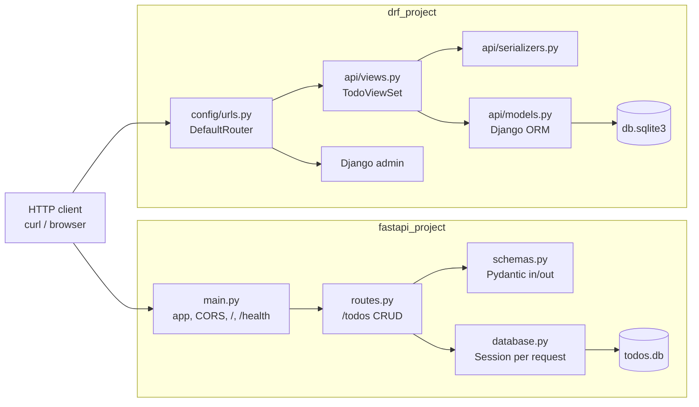

# FastAPI vs Django REST Framework

**A practical, side-by-side comparison of two Python API frameworks through the same Todo API, built twice in real, working, tested code.**

[](https://github.com/LuisEduardoGE/fastapi-vs-drf-comparison/actions/workflows/ci.yml)
[](LICENSE)


This repository contains **two complete implementations** of the same Todo CRUD API — `fastapi_project/` (FastAPI + SQLModel) and `drf_project/` (Django REST Framework) — so you can compare code structure and complexity, developer experience, built-in features, and async vs sync approaches when choosing a framework for your next project.

## Table of Contents

- [Features](#features)
- [Tech Stack](#tech-stack)
- [Architecture](#architecture)
- [Quick Start](#quick-start)
- [API](#api)
- [Key Differences at a Glance](#key-differences-at-a-glance)
- [Code Comparison Highlights](#code-comparison-highlights)
- [Testing](#testing)
- [Project Structure](#project-structure)

## Features

- The same Todo model (`id`, `title`, `description`, `completed`) and CRUD operations in both frameworks.
- FastAPI: typed SQLModel model, separate Pydantic request/response schemas, partial updates on `PUT`, Swagger UI at `/docs` and ReDoc at `/redoc`, `/health` endpoint.
- DRF: `ModelViewSet` + `DefaultRouter`, browsable API, Django admin with list filters and inline editing, page-number pagination (100 per page), `PATCH` support.
- SQLite in both, no external services.
- Test suites for both (pytest + `TestClient` for FastAPI, Django's test runner for DRF), run in CI.

## Tech Stack

| Layer | FastAPI project | DRF project |
|---|---|---|
| Framework | FastAPI 0.109.0 — modern async web framework | Django 4.2.9 + Django REST Framework 3.14.0 |
| Data layer | SQLModel 0.0.14 — SQL databases with Python type hints | Django ORM with migrations |
| Server | Uvicorn (ASGI) | Django development server (`runserver`) |
| Database | SQLite (`todos.db`) | SQLite (`db.sqlite3`) |
| Extras | CORS middleware | django-cors-headers, Django admin |
| Tests | pytest, FastAPI `TestClient`, in-memory SQLite | Django test runner, DRF `APITestCase` |

## Architecture



The two projects share nothing at runtime; each is a standalone app with its own SQLite file. FastAPI wires the database in through a `Depends(get_db)` dependency and creates tables on startup; DRF gets CRUD, routing and the browsable API from a single `ModelViewSet` registered on a router, with the schema managed by Django migrations.

## Quick Start

Prerequisites: Python 3.10+ (CI runs 3.10 and 3.12), `make` (optional).

```bash
python -m venv .venv
source .venv/bin/activate        # Windows: .venv\Scripts\activate
make install                     # both sub-projects + pytest, httpx, ruff

make run-fastapi                 # http://127.0.0.1:8000  (FASTAPI_PORT=...)
make run-drf                     # migrates, then http://127.0.0.1:8001  (DRF_PORT=...)
```

Without make, run each project from its own folder:

```bash
# FastAPI
cd fastapi_project
pip install -r requirements.txt
uvicorn app.main:app --reload            # http://127.0.0.1:8000

# DRF
cd drf_project
pip install -r requirements.txt
python manage.py migrate
python manage.py createsuperuser         # optional, for the admin panel
python manage.py runserver 8001          # http://127.0.0.1:8001
```

**FastAPI:** API root http://127.0.0.1:8000 · Swagger docs http://127.0.0.1:8000/docs · ReDoc http://127.0.0.1:8000/redoc

**DRF:** API root http://127.0.0.1:8001/api/ · Browsable API http://127.0.0.1:8001/api/todos/ · Admin panel http://127.0.0.1:8001/admin/

Each sub-project also has its own README: [`fastapi_project/README.md`](fastapi_project/README.md) and [`drf_project/README.md`](drf_project/README.md).

## API

Both projects expose a **Todo API** with full CRUD operations:

| Operation | FastAPI | DRF |
|---|---|---|
| Create a todo | `POST /todos/` | `POST /api/todos/` |
| List all todos | `GET /todos/` (plain list) | `GET /api/todos/` (paginated: `count`, `next`, `previous`, `results`) |
| Get a todo | `GET /todos/{id}` | `GET /api/todos/{id}/` |
| Update a todo | `PUT /todos/{id}` (only the fields sent) | `PUT /api/todos/{id}/` (full) · `PATCH /api/todos/{id}/` (partial) |
| Delete a todo | `DELETE /todos/{id}` → 204 | `DELETE /api/todos/{id}/` → 204 |
| Root / health | `GET /` · `GET /health` | `GET /` · `GET /api/` |

**Todo model:**

```json
{
  "id": 1,
  "title": "Buy milk",
  "description": "Remember to stop at the store",
  "completed": false
}
```

Create a todo:

```bash
# FastAPI
curl -X POST "http://127.0.0.1:8000/todos/" \
  -H "Content-Type: application/json" \
  -d '{"title":"Buy milk","description":"Remember to stop at the store","completed":false}'

# DRF
curl -X POST "http://127.0.0.1:8001/api/todos/" \
  -H "Content-Type: application/json" \
  -d '{"title":"Buy milk","description":"Remember to stop at the store","completed":false}'
```

List all todos:

```bash
curl "http://127.0.0.1:8000/todos/"       # FastAPI
curl "http://127.0.0.1:8001/api/todos/"   # DRF
```

## Key Differences at a Glance

| Aspect | FastAPI | Django REST Framework |
|--------|---------|----------------------|
| **Architecture** | Async-first, lightweight | Sync-first, full-featured |
| **Performance** | Very fast (async) | Moderate (sync) |
| **Type Hints** | Native, everywhere | Limited |
| **Auto Docs** | OpenAPI/Swagger built-in | Browsable API |
| **ORM** | SQLModel (optional) | Django ORM (integrated) |
| **Admin Panel** | None | Full admin interface |
| **Auth** | Manual/3rd-party | Built-in |
| **Learning Curve** | Easy for modern Python | Requires Django knowledge |
| **Best For** | Microservices, async APIs | Full web apps, monoliths |

In this repo the FastAPI handlers are `async def` but use a synchronous SQLModel session, so each database call blocks the event loop while it runs. That is fine for a demo; for real async throughput you would use plain `def` handlers (run in a thread pool) or an async database driver.

## Code Comparison Highlights

### Models

**FastAPI (SQLModel):**
```python
class Todo(SQLModel, table=True):
    id: Optional[int] = Field(default=None, primary_key=True)
    title: str
    description: str
    completed: bool = False
```

**DRF (Django ORM):**
```python
class Todo(models.Model):
    title = models.CharField(max_length=255)
    description = models.TextField()
    completed = models.BooleanField(default=False)
```

### Views/Endpoints

**FastAPI** (one function per operation):
```python
router = APIRouter(prefix="/todos", tags=["todos"])

@router.get("/", response_model=List[schemas.TodoResponse])
async def list_todos(session: Session = Depends(get_db)):
    return session.exec(select(models.Todo)).all()
```

**DRF** (one class for all five operations):
```python
class TodoViewSet(viewsets.ModelViewSet):
    queryset = Todo.objects.all()
    serializer_class = TodoSerializer
```

## Testing

```bash
make test            # both suites
make test-fastapi    # cd fastapi_project && python -m pytest -q
make test-drf        # cd drf_project && python manage.py test
make lint            # ruff check .
```

- **FastAPI — 11 tests pass.** `TestClient` against an in-memory SQLite database (the `get_db` dependency is overridden, so no `todos.db` is written): health and root, create, validation (422), list, get, partial update, delete, and 404 for get/update/delete of a missing todo.
- **DRF — 5 tests pass.** `APITestCase` on Django's throwaway test database: create, list, retrieve, update and delete.

## Project Structure

```
fastapi-vs-drf-comparison/
├── fastapi_project/          FastAPI implementation
│   ├── app/
│   │   ├── main.py           Application entry point, CORS, / and /health
│   │   ├── models.py         SQLModel database model
│   │   ├── schemas.py        Pydantic request/response schemas
│   │   ├── routes.py         /todos route handlers
│   │   └── database.py       Engine, table creation, session dependency
│   ├── tests/                pytest suite
│   └── requirements.txt
├── drf_project/              Django REST Framework implementation
│   ├── config/               Django settings, URL routing, WSGI/ASGI
│   ├── api/                  Model, serializer, ViewSet, admin, migrations, tests
│   ├── manage.py
│   └── requirements.txt
├── requirements-dev.txt      Both projects + test and lint tools
├── ruff.toml                 Lint configuration
└── Makefile                  install / run-fastapi / run-drf / test / lint / clean
```

## Author

**Luis Eduardo G. Espindola** · [GitHub](https://github.com/LuisEduardoGE) · [LinkedIn](https://www.linkedin.com/in/luisgespindola/)

## License

[MIT](LICENSE) © Luis Eduardo G. Espindola
